# BahtBuddy

BahtBuddy is a money app for a student in Thailand. It keeps income and
spending in a SQLite ledger on the phone, in English or Thai. A bank slip can
start the record. The student still presses Save before anything is stored.

## The problem

A week of small payments is easy to lose. A coffee, a bus fare, or a transfer
disappears once the confirmation screen closes, and the month becomes a guess.

A notebook stays private and needs no network. The student still copies every
amount by hand. A notebook cannot read a slip, hold a category budget, or show
how the month is going.

A bank app confirms the transfer. Cash, a personal category such as food or
transport, and a plain reading of this month sit outside that screen. Copying
the same transfer into another tracker is the step people skip.

The slip already carries the amount, the date, the recipient, and a reference.
BahtBuddy starts from that slip, or from a typed amount, and leaves the ledger
on the phone.

## How a record is saved

1. Open Add and choose the camera, a photo already on the phone, or a typed amount.
2. A photo is read on the phone. Tesseract reads Thai and English, then ML Kit reads the Latin text. The picture stays on the phone.
3. The parser fills the amount, date, recipient, and reference. The form stays a draft.
4. Save writes one row to SQLite. Home, History, Budgets, and Reports then read that same ledger.

After that, Home divides this month's balance by the days left, including
today, and shows that as safe to spend. Reports show the category split, the
comparison with the previous period, and up to three tips from fixed rules.
Settings can lock the app with a PIN and seal a JSON backup with that PIN.
Exchange rates and BBC business headlines are read from the network and cached
on the phone. Those two reads leave the ledger unchanged.

## App pages

These are the screens from the Android debug build on 25 November 2026.
System, English, and Automatic were selected. The phone was in light mode, so
the pictures use the daylight look. The ledger already on the phone was
฿600.00 income and ฿20.00 food expense, so this month is ฿580.00. No record
was saved while the pictures were taken.

<table>
  <tr>
    <td align="center" width="33%">
      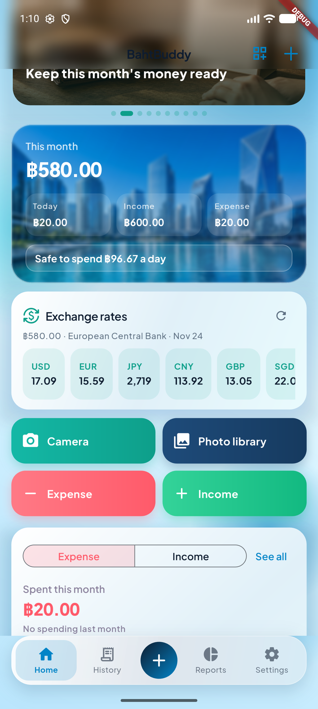<br>
      <b>Home</b><br>
      This month ฿580.00. Safe to spend ฿96.67 a day.
    </td>
    <td align="center" width="33%">
      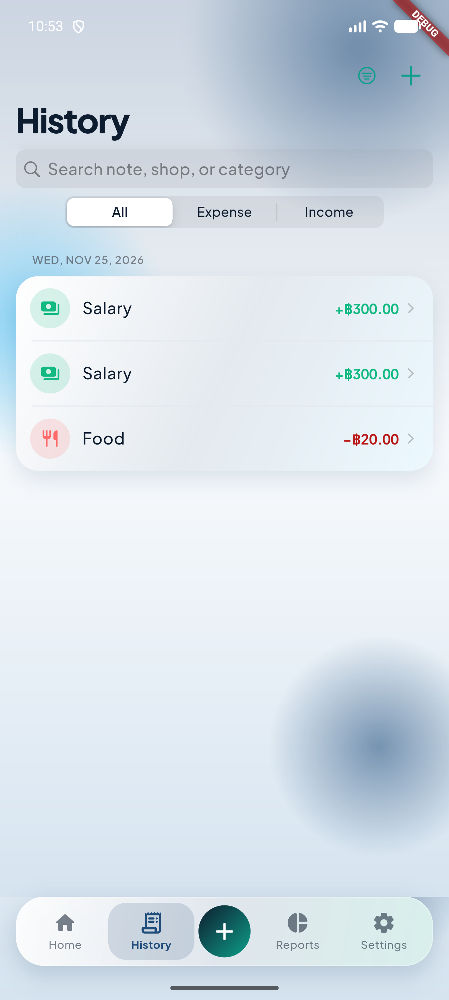<br>
      <b>History</b><br>
      Wed, Nov 25, 2026. Two salary rows and one food expense.
    </td>
    <td align="center" width="33%">
      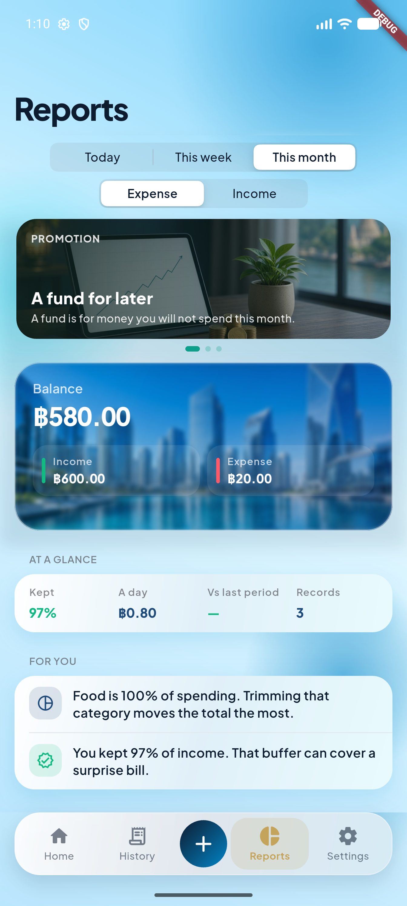<br>
      <b>Reports</b><br>
      Kept 97%. A day ฿0.80 is this month's average expense.
    </td>
  </tr>
  <tr>
    <td align="center">
      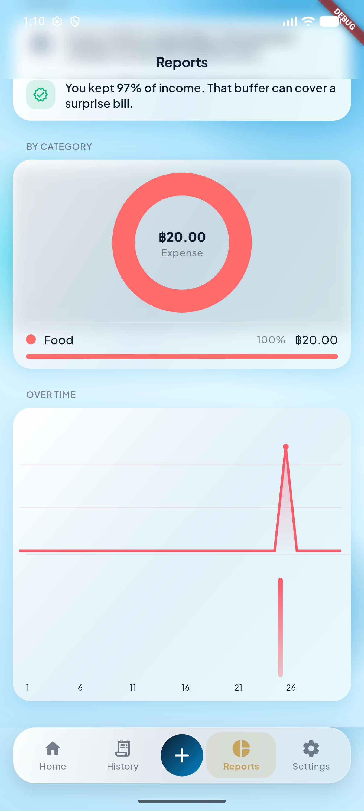<br>
      <b>Reports, charts</b><br>
      Food is the whole ฿20.00 ring.
    </td>
    <td align="center">
      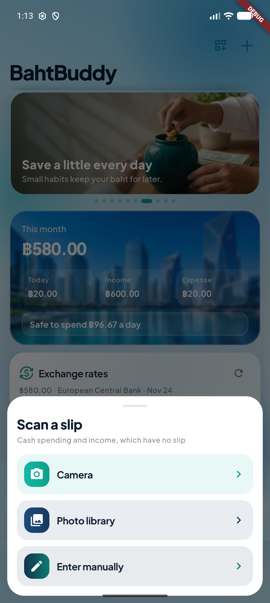<br>
      <b>Add</b><br>
      Camera, photo library, or enter manually.
    </td>
    <td align="center">
      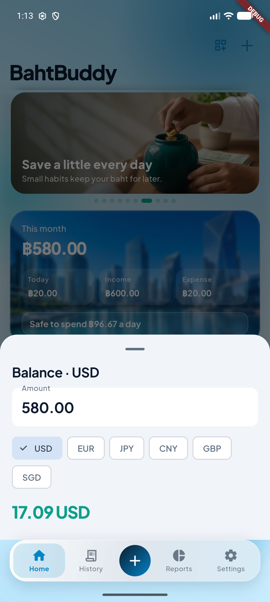<br>
      <b>Exchange</b><br>
      ฿580.00 is 17.09 USD on the 24 Nov board.
    </td>
  </tr>
  <tr>
    <td align="center">
      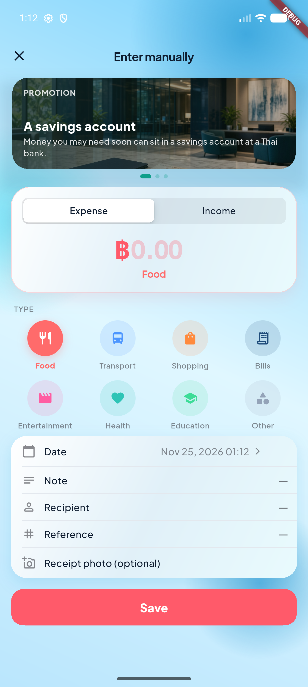<br>
      <b>Expense</b><br>
      Food, ฿0.00. Save was not pressed.
    </td>
    <td align="center">
      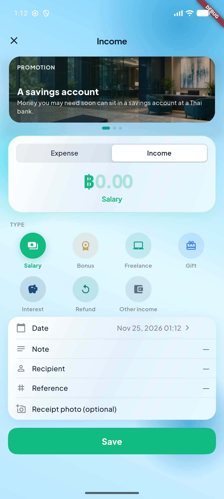<br>
      <b>Income</b><br>
      Salary, ฿0.00. Save was not pressed.
    </td>
    <td align="center">
      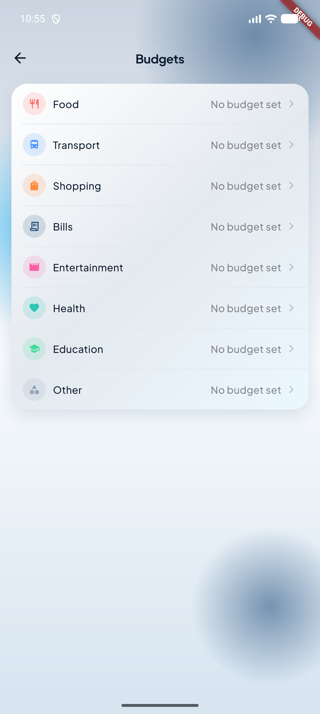<br>
      <b>Budgets</b><br>
      Every category says no budget set.
    </td>
  </tr>
  <tr>
    <td align="center">
      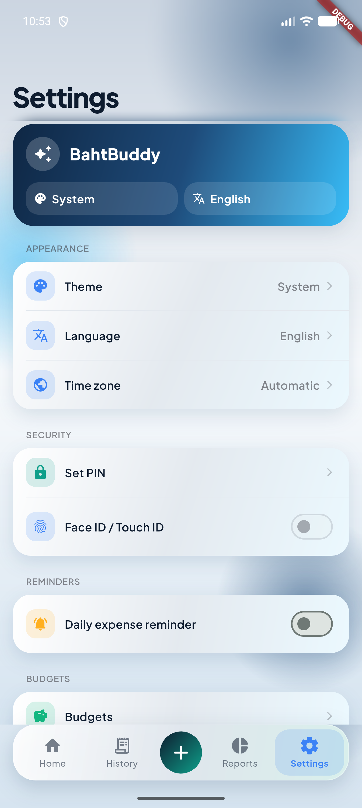<br>
      <b>Settings</b><br>
      System, English, and Automatic.
    </td>
    <td align="center">
      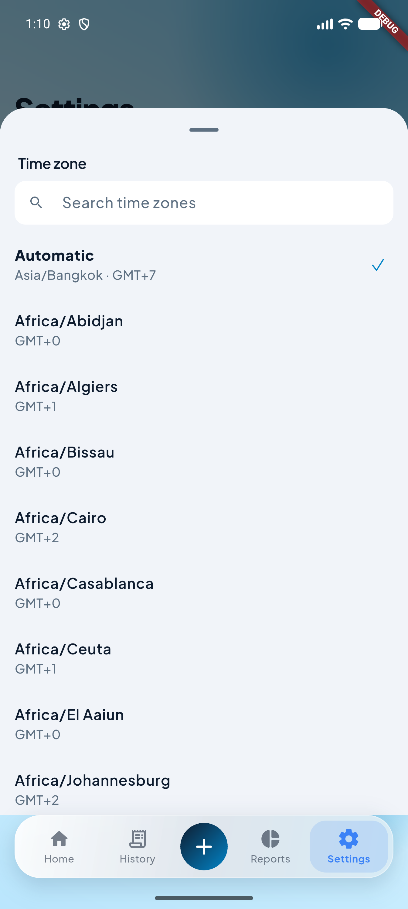<br>
      <b>Time zone</b><br>
      Automatic is Asia/Bangkok, GMT+7.
    </td>
    <td></td>
  </tr>
</table>

## ITCS259 Submission

The final report and slide deck are in [`docs/ITCS259/`](docs/ITCS259/):

- [`BahtBuddy_Project_Report.pdf`](docs/ITCS259/BahtBuddy_Project_Report.pdf)
- [`BahtBuddy_Presentation_Slides.pdf`](docs/ITCS259/BahtBuddy_Presentation_Slides.pdf)

The report and slides include the emulator screens, the architecture, the
Drift schema, the test evidence, the limits, the team responsibilities, and
the references. Section 1.4 of the report maps the app to the course
proposal: a Flutter expense tracker stored in SQLite on the phone.

## Requirements

- Flutter 3.x
- Dart 3.x
- Android Studio/SDK for Android
- A Mac with Xcode to build or run the iPhone app
- An emulator, simulator, or supported physical device

## Installation

```bash
flutter pub get
flutter test
```

## Android and iOS use the same app

One Flutter tree drives both phones. The screens, ledger, slip and receipt
reading, budgets, reports, PIN, backup, exchange rates, and news banner are
shared. The Material theme forces the same look on iPhone and Android.

| Feature | Android | iOS |
| --- | --- | --- |
| Manual expense and income | Yes | Yes |
| Camera / photo library slip or receipt | Yes | Yes |
| Tesseract Thai+English, then ML Kit Latin | Yes | Yes |
| Local SQLite ledger | Yes | Yes |
| Budgets and local reminders | Yes | Yes |
| PIN and biometrics | Fingerprint / face | Face ID / Touch ID |
| JSON backup and CSV share | Yes | Yes |
| Exchange rates and BBC headlines | Yes | Yes |

There is no separate macOS desktop app. A Mac is used to compile and run the
**iOS** build. Google ML Kit does not ship a macOS desktop target for this
project.

## Android

```bash
flutter run -d <android-device-or-emulator>
```

## iOS on a Mac

```bash
flutter pub get
bash ios/download_mlkit_bundles.sh
bash ios/download_libtesseract.sh
bash tools/mac_ios_run.sh
```

Or step by step:

```bash
flutter pub get
bash ios/download_mlkit_bundles.sh
bash ios/download_libtesseract.sh
flutter devices
flutter run -d <iphone-simulator-or-device>
```

If a plugin needs CocoaPods instead of Swift Package Manager:

```bash
cd ios
pod install
cd ..
flutter run
```

Camera, photo library, Face ID, notifications, https story links, and the ML
Kit Latin bundle are configured under `ios/`. Open
`ios/Runner.xcworkspace` in Xcode when you need signing for a physical iPhone.

## How the Application Works

### Application startup and navigation

`lib/main.dart` initializes Flutter and starts a `ProviderScope`. The app in
`lib/app.dart` loads the saved locale and theme, configures `go_router`, and
places the selected route behind the optional lock gate. The main navigation
uses a stateful shell with Home, History, Reports, and Settings. Entry and
Budgets are separate routes.

### State and data flow

Screens watch Riverpod providers in `lib/providers.dart`. The providers expose
live Drift streams for transactions, categories, and budgets, and asynchronous
state for preferences, exchange rates, and the Home card layout. A change made
through a repository is written to SQLite; Drift then emits updated data to
subscribed screens, so totals and reports refresh from the same ledger.

The normal transaction path is:

1. The user enters an expense/income manually or chooses a slip image.
2. The entry form collects or reviews amount, date, category, note, recipient,
   reference, and optional image.
3. `TransactionRepository` checks for an existing non-empty slip reference.
   The same row can retain its reference while being edited.
4. The repository inserts or updates the transaction using `AppDatabase`.
5. If a recipient is present, its normalized name and chosen category are
   stored as a learned rule for later suggestions.
6. Riverpod/Drift updates Home, History, Budgets, and Reports.

### Slip scanning and OCR

Camera and gallery actions are provided by `image_picker`. The selected image
is copied into the app's documents storage. `SlipOcr` reads the picture on the
phone with Tesseract's Thai and English models, then with ML Kit's Latin
recognizer. It does not upload the image to a BahtBuddy server. `SlipParser` applies prioritized regular expressions to
extract an amount, date/time, recipient, and transaction reference. It
recognizes common English and Thai labels and Buddhist-year dates. A rendered
set of 20 confirmation screens was read on the emulator: amount and date
matched on every screen, recipient and reference on 19 of 20, and 18 screens
matched all four fields. OCR output opens as an editable draft and is never
saved without user confirmation.

Category suggestions use recipient keywords first and may be overridden by a
learned recipient rule. A duplicate slip reference is rejected by the
repository and is also protected by the unique SQLite column.

### Local database and calculations

`lib/data/db/app_database.dart` defines the Drift schema and migrations:

- `Categories`: bilingual category labels and income/expense classification
- `MoneyTransactions`: amount, type, category, date, note, recipient, slip
  reference, and image path
- `Budgets`: monthly limit per category
- `RecipientRules`: learned recipient-to-category mappings
- `Preferences`: theme, locale, PIN hash, biometrics, reminder, and time zone

The ledger database is local SQLite. The Home card arrangement and exchange
rates are stored as local JSON files. Reports and budget progress derive from
the transaction records and selected date ranges; they do not depend on a
remote analytics service.

### Reports, budgets, and notifications

Reports summarize the selected day, week, or month, compare it with the
previous period, plot category/period data, and select up to three tips from
deterministic rules. Rules include category concentration, period change,
remaining-income buffer, and daily spending pace. These are explainable
threshold rules, not generated financial advice.

Budgets store one monthly limit per category. After an expense is saved, local
notification logic can notify the user when spending crosses the configured
warning and limit levels. A daily reminder is optional and can be configured
in Settings.

### Network, security, and backups

Frankfurter exchange rates and the BBC News business RSS feed are the two
network reads. Neither writes the ledger. Rates are converted into baht and
cached locally. When the phone has no saved board, the chips use a board
shipped with the app, dated 23 November 2026. A successful refresh replaces
that file. The home banner also shows four general notes that ship with the
app, then up to four cached BBC headlines. A failed request shows the last
saved headlines and does not invent one. The ledger remains usable offline. The app can be protected with a PIN and device-supported
biometrics. A new PIN is stored as a salted hash; a PIN saved with the older
single hash still unlocks. CSV export provides a spreadsheet the user can open.
JSON backup is sealed with AES-GCM under the PIN and covers categories,
transactions, budgets, recipient rules, and preferences. An older plaintext
backup still restores.

### Internationalization and presentation

English and Thai strings are generated from the localization resources. Theme
preferences, including system appearance, are persisted in preferences. App
assets include the bundled Plus Jakarta Sans font and Home promotional
graphics. The Android and iOS folders contain the respective platform
configuration; an iOS binary requires macOS and Xcode.

## Test Status

The complete Flutter suite passed **37 tests** on 26 November 2026. Coverage
includes slip parsing, the 20 labeled slip texts, duplicate references, Bangkok
time zones, history filters, PIN behavior, the salted PIN hash, a sealed
backup, exchange-rate conversion, the BBC headline parser, report tips,
manual-entry and slip-confirmation widget workflows, a debug open that starts
on the system theme, and a release open that keeps the theme chosen in
Settings.

To regenerate the academic PDFs, install the Python ReportLab dependency if
needed, then run from the repository root:

```powershell
python docs\ITCS259\build_final_deliverables.py
```

## Source

https://github.com/Sakkaraj/BahtBuddy
